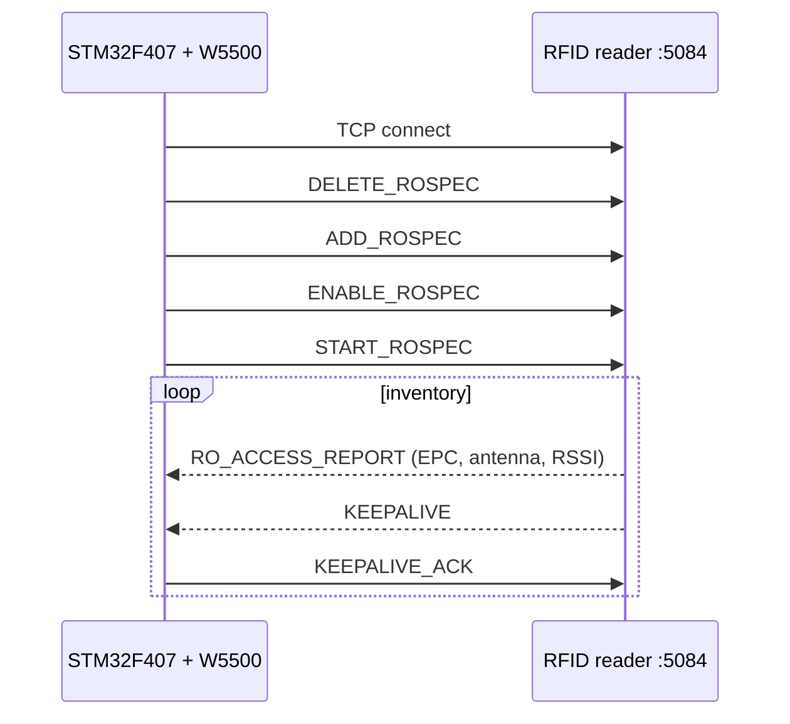

# W5500 LLRP RFID Reader Client


An STM32F407 acting as an **LLRP (Low Level Reader Protocol) client** for UHF RFID readers. It talks to a **WIZnet W5500** Ethernet chip over SPI using its own register-level driver — no HAL, no RTOS, no LwIP — opens a TCP connection to the reader on port **5084**, configures an inventory, and parses the reader's binary reports to print each tag's **EPC, antenna and RSSI** over UART.

## Features

- **SPI1 + W5500 driver** written from the datasheet: common registers (MAC, gateway, subnet, IP), socket 0 in TCP client mode, TX/RX buffer pointers, `SEND`/`RECV` commands, PHY link check
- **Connection state machine** on the socket status register (`CLOSED → INIT → ESTABLISHED`) with **automatic reconnect** and a fresh source port on every attempt
- **LLRP setup sequence**: `DELETE_ROSPEC` → `ADD_ROSPEC` → `ENABLE_ROSPEC` → `START_ROSPEC`
- **`KEEPALIVE` handling**: answers every keep-alive with `KEEPALIVE_ACK` so the reader keeps the session open
- **`RO_ACCESS_REPORT` parser**: walks the message headers and `TagReportData` parameters, extracts `EPC-96`, `AntennaID` and `PeakRSSI`, with bounds checks against the message length

Example output line format:

```
[ETIKET] EPC: <24 hex digits> | Ant: <n> | RSSI: <dBm> dBm
```

## Hardware

| Part | Notes |
|---|---|
| STM32F407G-DISC1 | Default 16 MHz HSI clock |
| WIZnet W5500 Ethernet module | SPI, 3.3 V |
| LLRP-capable UHF RFID reader | Connected directly or through a switch |
| USB–TTL serial adapter | 115200 baud, 8N1 |

### Wiring

| Signal | STM32 pin | W5500 / adapter |
|---|---|---|
| SPI1_SCK | PA5 | SCLK |
| SPI1_MISO | PA6 | MISO |
| SPI1_MOSI | PA7 | MOSI |
| CS (GPIO) | PA4 | SCSn |
| USART2_TX | PA2 | USB–TTL RX |
| 3.3 V / GND | 3V / GND | VCC / GND |

The W5500 is reset in software (`MR` register); its RST pin is not driven.



## Network configuration

Set in `Core/Src/main.c` (defaults use the link-local range, e.g. for a direct cable to the reader):

| Setting | Default |
|---|---|
| `LOCAL_IP` (W5500) | `169.254.1.100` |
| `TARGET_IP` (reader) | `169.254.1.1` |
| `SUBNET_MASK` | `255.255.0.0` |
| `GATEWAY_IP` | `169.254.1.1` |
| `READER_PORT` | `5084` |

## Build and flash

Requires the [Arm GNU Toolchain](https://developer.arm.com/downloads/-/arm-gnu-toolchain-downloads) (`arm-none-eabi-gcc`) and GNU Make.

```bash
make            # -> build/W5500_LLRP_RFID_Reader.elf / .bin
make flash      # uses st-flash (stlink tools)
```

Or flash the `.elf` with STM32CubeProgrammer / STM32CubeIDE, then open a terminal at 115200 baud.

## Known limitations

- The `ADD_ROSPEC` message is a fixed byte array (one ROSpec, ID 1); reader configuration is not negotiated.
- The parser handles the `EPC-96`, `AntennaID` and `PeakRSSI` TV parameters and stops at any other parameter inside `TagReportData`. Messages split across two TCP reads are dropped.
- Delays between setup messages are busy-wait loops.

---

### 🇹🇷 Türkçe özet

STM32F407'yi UHF RFID okuyucular için **LLRP istemcisi** yapan proje. WIZnet W5500 Ethernet çipi SPI üzerinden, HAL/RTOS/LwIP olmadan register düzeyinde sürülüyor; okuyucuya 5084 portundan TCP bağlantısı açılıyor, `DELETE/ADD/ENABLE/START_ROSPEC` dizisiyle envanter başlatılıyor, `KEEPALIVE` mesajları yanıtlanıyor ve `RO_ACCESS_REPORT` paketleri ayrıştırılarak her etiketin EPC, anten ve RSSI bilgisi UART'tan (PA2, 115200) basılıyor. Bağlantı koparsa otomatik yeniden bağlanıyor.
